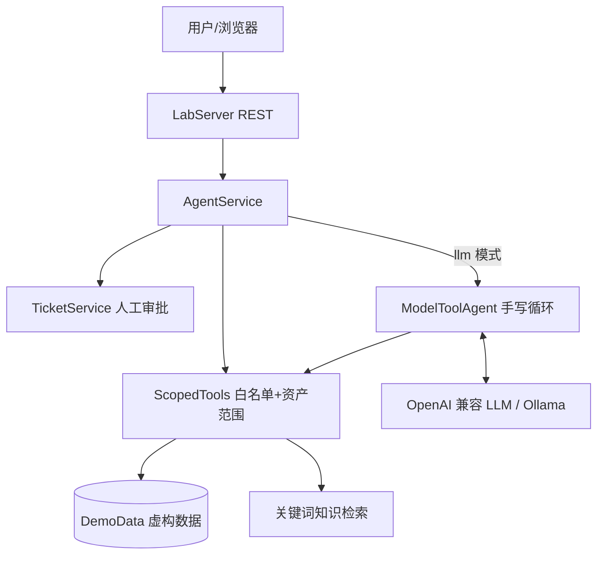
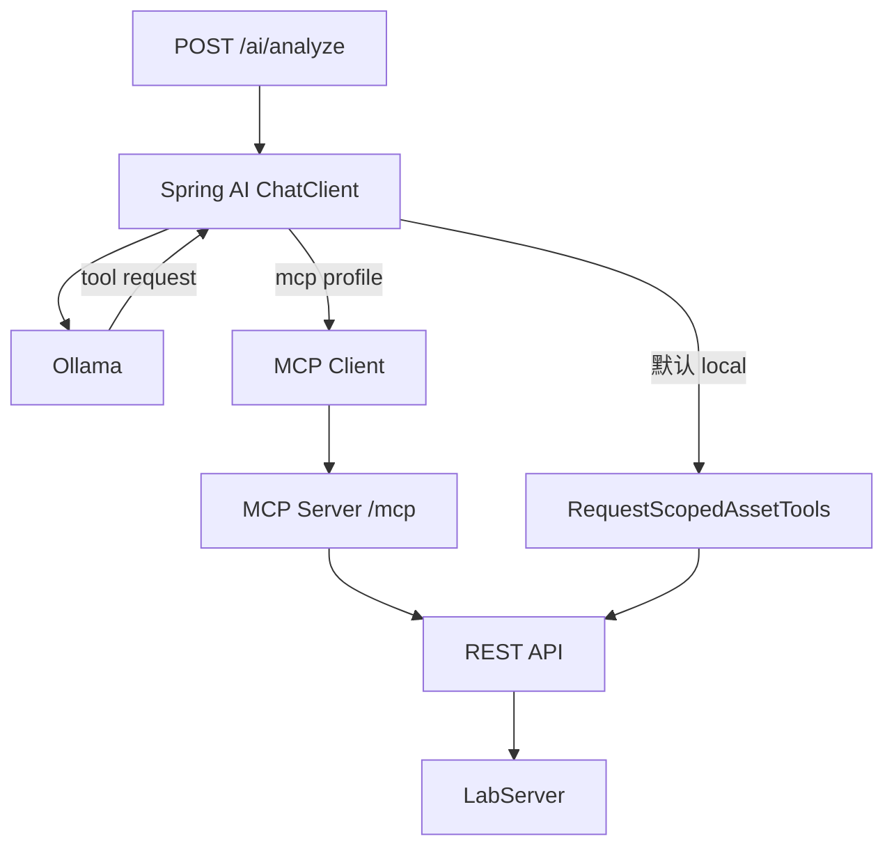

# 第 2 课：架构和完整执行链路

## 两条可运行/可学习的技术路径

**demo 模式**：`AgentService -> ScopedTools -> DemoData -> Report`，完全确定性，不调用模型。  
**llm 模式**：上述过程之外，`ModelToolAgent` 再把工具定义发送模型，模型请求工具，Java 验证并调用，最终模型给出解释。

## Spring AI 与 MCP 扩展

注意：本项目使用 MCP 复用既有 REST API，绝不是把业务数据复制到 MCP Server 内部。

## 五个核心边界

1. **模型**：负责提出调用工具的请求、整合工具结果与解释，不持有数据库访问权限。
2. **Tool 调度层**：定义能力、解析参数、白名单和范围校验；不信任模型传入的 `ip`。
3. **业务数据层**：负责数据访问及权限。真实项目必须再次强制授权，形成纵深防御。
4. **安全规则层**：确定性评分与状态迁移，不交给模型自由决定。
5. **人工审批**：创建正式整改工单或执行高风险动作必须经过可信服务端审批机制。

## 一次请求的 12 个步骤

1. 客户端提交目标 IP 与问题。
2. Java 创建请求范围工具，检查当前资产是否属于允许的租户。
3. Java 向模型传入自然语言问题和可用工具 Schema（真实 LLM 模式）。
4. 模型可能返回一个或多个 `tool_calls`。
5. Java 解析工具名称与 JSON 参数。
6. `ScopedTools` 强制校验工具在白名单，且 `ip` 与授权目标相等。
7. 工具实际访问模拟资产数据、漏洞或知识库。
8. Java 将工具结果以 `role=tool` 返还给模型。
9. 模型再决定下一步调用工具或输出解释。
10. Java 根据实际扫描记录使用确定性规则给出示例评分，并组装来源与 trace。
11. 报告写入本地内存，供工单草稿引用。
12. **独立的人工请求**创建草稿/执行审批，AI 无法直接调用正式审批动作。

## 失败路径必须明确

| 问题                       | 系统反应                                   |
|----------------------------|--------------------------------------------|
| 未知资产 IP                | 400，不调用 LLM                            |
| 不属于当前租户             | 403，不调用 LLM                            |
| 模型尝试跨资产调用 Tool    | Tool 返回/抛出拒绝；模型不能绕开 Java 校验 |
| 模型无限请求工具           | 超出轮数停止并报错                         |
| 知识库无命中               | 证据列表为空，禁止编造来源                 |
| 模型接口不可达             | 502，用户可用 demo 模式完成教学流程        |
| 审批码错误                 | 403                                        |
| 同一次分析重复生成工单草稿 | 返回相同工单 id                            |
| 工单重复审批               | 400，拒绝再次迁移                          |

## 为什么已有微服务不直接变成 MCP？

MCP 是 **工具接入协议**，不是代替你的原有 Spring Boot Service、Feign 或数据库。起步时直接 `@Tool -> Service` 更容易调试；有多个
Agent 消费同一组工具时，再把稳定 API 包装成 MCP 提供方。只有当复用价值超过额外运维、认证和故障处理成本，才值得分离部署。
