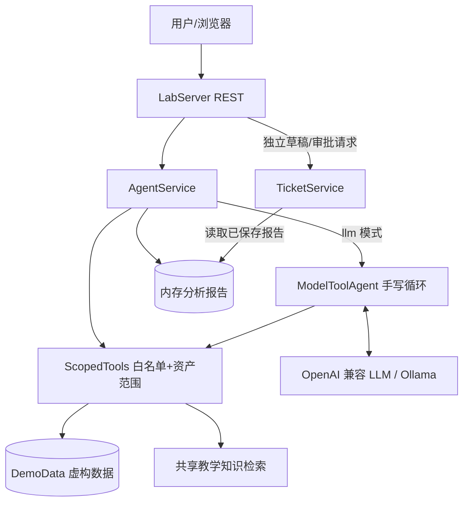
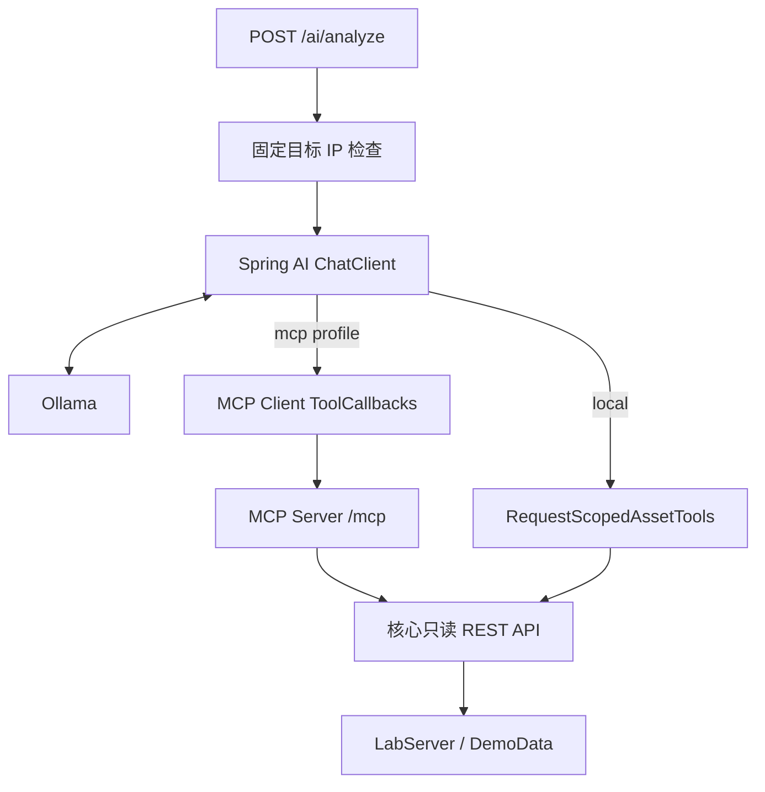

# 第 2 课：架构和完整执行链路

## 离线核心的两种执行模式

**demo 模式**：Java 查询资产、漏洞和对应知识文档，按确定性规则评分并生成报告，不调用模型。

**llm 模式**：先执行同样的 Java 预查询和评分，再向模型提供工具定义。模型请求工具时，由 Java 校验并执行，结果返回模型以生成辅助解释。预查询的证据不会自动加入模型对话，模型仍须调用对应工具才能收到这些数据。

`toolTrace.origin=java-orchestrator` 表示固定 Java 编排，`llm-request` 表示执行了模型发出的请求。只有后者能证明该工具由模型选择；失败的工具调用不会写入成功轨迹。

## Spring AI 与 MCP 扩展

本地 `@Tool` 对象通过 `.tools(...)` 注册；MCP `ToolCallbackProvider` 通过 `.toolCallbacks(...)` 注册。MCP Server 复用已有 REST API，不保存业务数据副本。

Spring `/ai/analyze` 返回模型答复，不经过离线版 `AgentService.analyze`，因此没有结构化风险评分、报告保存或审批链路。Spring Agent 和 MCP Server 默认均只允许 `192.0.2.10`；核心 API 会进一步校验资产是否属于固定演示租户。

## 五个核心边界

1. **模型**：提出工具请求并解释结果；不能直接访问数据库或修改业务记录。
2. **工具调度层**：限制可用工具并校验参数；不信任模型传入的资产 IP。
3. **业务数据层**：离线核心对资产实施固定租户检查。教学知识库是共享虚构资料，没有文档级租户授权。
4. **规则层**：离线版的结构化评分与工单状态迁移由 Java 控制；模型的自然语言解释仍可能出错。
5. **人工审批接口**：用户独立创建草稿并输入演示审批码；当前仅记录 `DRAFT -> APPROVED`，不会创建外部正式工单。

## 离线 llm 请求的 12 个步骤

1. 客户端提交 IP、模式和问题，HTTP 层验证实验口令。
2. `ScopedTools` 构造时验证资产存在且属于 `tenant-blue`。
3. Java 预先调用资产、漏洞和知识工具，去重知识证据并计算示例评分。
4. `ModelToolAgent` 将用户问题和工具 Schema 发送模型。
5. 模型返回一个或多个 `tool_calls`，或直接返回文字。
6. Java 解析工具名和参数，校验白名单、字符串字段及额外参数限制。
7. 资产工具检查 IP 等于当前授权目标，知识工具检查查询长度。
8. Java 执行工具，将结果或调用错误以 `role=tool` 返回模型。
9. 模型继续请求工具或生成解释；模型请求最多 6 轮，每轮可能包含多个工具调用。
10. Java 使用此前计算的评分、预查询证据及全部成功轨迹组装报告，模型不能改写结构化评分字段。
11. 仅在模型流程成功后将报告写入内存；模型失败不会保存为成功报告。
12. 用户另行请求草稿创建和审批；这些动作不在模型工具列表中。

## 失败路径

下表的 HTTP 状态针对离线 `/api/*`；Spring `/ai/analyze` 的契约见第 3 课。

| 问题 | 系统反应 |
|------|----------|
| 未知资产 IP | 400，不调用模型 |
| 资产不属于固定租户 | 403，不调用模型 |
| 模型请求跨资产、未知工具或非法工具参数 | 工具拒绝执行，调用错误返回模型，不能绕过 Java 检查 |
| 模型连续 6 轮均请求工具 | 502，不保存报告；这是轮数上限，不是工具次数上限 |
| 模型服务不可达、返回 HTTP 错误或无效协议数据 | 502，需用户显式选择 demo，不自动回退 |
| 知识无命中 | 证据为空；提示词要求模型不得编造，但尚无服务端引文校验 |
| 审批码错误 | 403 |
| 同一分析重复创建草稿 | 返回同一工单 ID，可能已是 APPROVED 状态 |
| 重复审批 | 400，拒绝再次迁移 |

## 为什么已有微服务不直接变成 MCP？

MCP 是工具接入协议，不代替原有 Spring Boot Service、Feign 或数据库。起步时直接 `@Tool -> Service` 更容易调试；多个 Agent 需要复用稳定工具时，再增加 MCP 适配层。是否独立部署应取决于复用价值、授权边界和运维成本。
