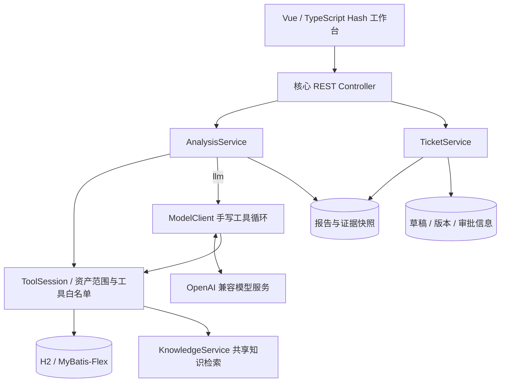
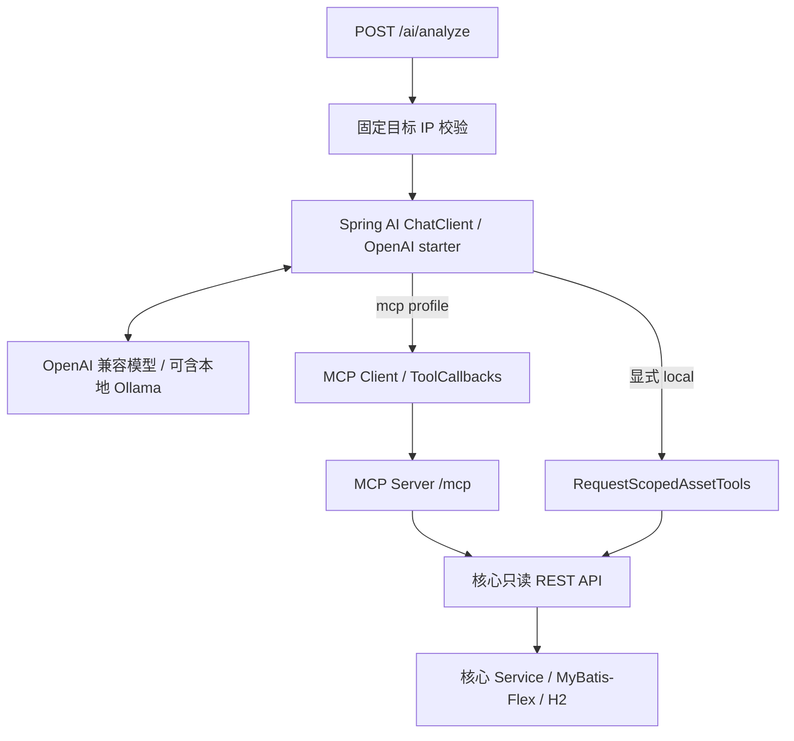

# 第 2 课：架构与完整执行链路

本文对应 2026-10-22 的代码，配置、接口与已知限制分别见[第 3 课](03-API与运行示例.md)和[核验记录](09-核验记录.md)。

## 工作台与核心

Vue 的列表页使用数据库分页 API，查询条件存入 Hash 路由；详情页按 IP 或稳定 ID 读取。生产资源由 Maven 放进核心 JAR 的 `static/`，开发时由 Vite 代理 `/api`。

**demo**：Java 查询授权资产、漏洞与对应知识，按规则评分，保存报告；不调用模型。

**llm**：执行相同预查询和评分，再由 `ModelClient` 进行 Chat Completions 多轮请求。模型只负责解释与申请只读工具，结构化评分由 Java 保留。当前核心工具 Schema 的 `parameters` 构造存在已知问题，尚未完成真实模型兼容验证；假模型仅验证循环和工程行为。

资产、漏洞在 `ToolSessionFactory` 的短只读事务中固定；模型调用期间不持有该事务。知识在调用时检索并去重，报告保存实际使用的正文与来源快照。

## Spring AI 与 MCP

local 用 `.tools(...)` 扫描普通对象的 `@Tool` 方法；MCP 用 `.toolCallbacks(provider)` 注册回调。MCP Server 转发既有 API，不维护数据库副本。

Agent 需要三个模型环境变量。无 profile 时当前业务配置选择 MCP，而 Client 关闭；local 必须显式加 `--lab.tool-backend=local`，MCP 则启用 `--spring.profiles.active=mcp`。没有自动降级。

`/ai/analyze` 不经过核心 `AnalysisService.analyze`，因此不创建核心报告、评分和工单；Vue 工作台也未接入此接口。Agent 与 MCP 默认只允许 `192.0.2.10`，核心再校验固定租户。

## 离线模型请求的执行顺序

1. 客户端提交 `ip`、`mode` 和问题，HTTP Filter 验证实验口令、请求容量并设置 traceId。
2. `ToolSessionFactory` 校验资产归属并固定资产 / 漏洞快照。
3. Java 调用资产、漏洞和每条漏洞的知识检索工具，去重证据并计算教学评分。
4. `ModelClient` 将系统提示、用户问题和工具定义发给配置的模型地址；预查询证据未自动写进模型消息。
5. 模型可直接回答，也可返回一个或多个 `tool_calls`。
6. Java 解析工具名和参数；资产工具要求 IP 等于当前目标，知识工具限制查询长度。
7. 调度执行后将结果或拒绝信息以 `role=tool` 返回模型。
8. 循环受模型阶段的轮数、工具次数、响应下载与时间预算限制。
9. 成功后将规则评分、证据和成功工具轨迹组装为报告，在短事务中原子保存。
10. 用户另行请求创建草稿、编辑和审批；这些动作不在模型工具列表中。

`origin=java-orchestrator` 是固定编排，`origin=llm-request` 是成功执行的模型请求。失败工具调用、最终模型消息不属于成功工具轨迹；模型失败时也不会保留成功报告。

## 业务边界与失败路径

| 情况                                | 核心行为                           |
| ----------------------------------- | ---------------------------------- |
| 未知资产 / 跨租户资产               | 400 / 403，在模型调用前拒绝        |
| 非法工具、参数或跨资产 IP           | 工具拒绝，错误信息返回模型         |
| 知识无命中                          | 空证据；没有服务端引文真实性校验   |
| 模型网络、协议或预算失败            | 502，不保存成功报告，不自动转 demo |
| 并发分析容量耗尽                    | 429                                |
| 同一分析重复创建草稿                | 返回已有工单，可能已审批           |
| 编辑 / 审批版本过期                 | 409                                |
| 已审批工单用当前版本再次编辑 / 审批 | 400                                |
| 审批码错误                          | 403                                |

核心业务表按配置的固定租户过滤，知识库为共享训练资料。工单唯一约束与乐观锁保证本机教学流程；模拟审批人、实验口令和 MCP 协议均不等于生产身份授权。

已有 REST / RPC 能力可以继续承担业务边界，MCP 仅作为工具描述、发现和跨客户端调用的适配层。
