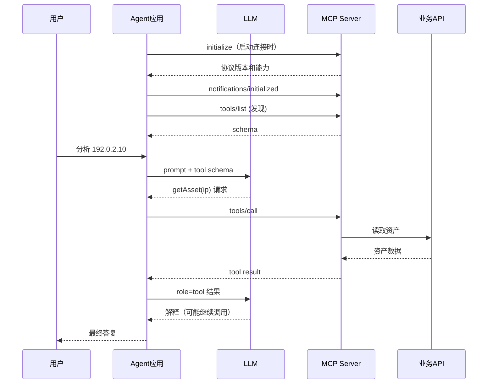

# 第 4 课：Tool Calling 与 MCP（结合源码）

## A. 先用一句话记忆

- **Tool Calling**：模型说「我需要调用 `get_asset({ip: ...})`」，宿主 Java 程序根据工具 Schema、权限与代码执行。
- **MCP**：规范「外部工具提供方如何向 Agent 暴露工具、查询工具列表和发起调用」。
- **两者可组合**：`LLM Tool Calling -> Spring AI MCP Client -> MCP Server -> Java Service`。

## B. 手写模型交互（不是假 Agent）

在 `ModelToolAgent.java` 中，工具以 OpenAI 兼容格式传入：

```json
{
  "tools": [
    {
      "type": "function",
      "function": {
        "name": "get_asset",
        "description": "查询资产",
        "parameters": {
          "type": "object",
          "properties": {
            "ip": {
              "type": "string"
            }
          },
          "required": [
            "ip"
          ]
        }
      }
    }
  ]
}
```

模型可返回：

```json
{
  "role": "assistant",
  "tool_calls": [
    {
      "id": "call_1",
      "type": "function",
      "function": {
        "name": "get_asset",
        "arguments": "{\"ip\":\"192.0.2.10\"}"
      }
    }
  ]
}
```

**模型没有执行 Java**。`ScopedTools.call()` 真正执行工具，结果通过下一条 `role=tool` 消息返回模型，模型可继续调用其他工具或回答。

在单元测试 `FakeModelTest.java` 中可以找到真实的 **两轮协议对话**，不依赖任何模型即可验证这个机制。

## C. MCP 是什么、不是什么

MCP 提供 `initialize`、`tools/list`、`tools/call` 等标准能力（还有资源、提示模板等）。MCP Server 可以经本地 STDIO 或远程
Streamable HTTP 被调用，它不是「又一个需要大模型的服务」，也不是「所有 Tool 的强制执行方式」。

本工程显式配置 `protocol: STREAMABLE`（WebMVC Starter 未配置此属性时默认为 SSE）。STDIO 通常由客户端启动独立子进程，不等于 Agent JVM 内的方法调用。`mcp-server` 不复制任何业务数据，而是复用现有 `offline-lab` REST API；任何使用 MCP 的 AI 客户端只需遵循同一工具协议。



## D. 为什么不是所有 Tool 都用 MCP？

本地简单工具：`Agent JVM -> Java @Tool 方法`。远程 MCP 工具：`Agent JVM -> HTTP -> MCP Server -> 原有 Java 业务 API`
，多出了网络、连接、授权策略、协议配置与故障点。

**建议的决策**：

- 当前只有一个 Java Agent 使用某项业务能力：优先本地 Tool / Feign / SDK。
- 公司已经有成熟 REST/RPC 接口：本地 Tool 封装 HTTP 请求就可以，没必要先重写 MCP。
- 多个 Java/Python/桌面 AI 客户端都要使用同一组资产工具：可把稳定接口增加 MCP 适配层。
- 需要把工具权限开放给其他团队：MCP 并不自动保证安全，仍要做认证授权和审计。

## E. 框架迁移练习

1. 在 `ScopedTools` 添加 `get_asset_ports(ip)`；重新运行测试。
2. 在 `RequestScopedAssetTools` 添加对应的 `@Tool` 方法；若要保持 `get_asset_ports` 这一工具名，需要显式设置 `@Tool(name = "get_asset_ports")`。
3. 在 `McpAssetTools` 添加对应的 `@Tool` 方法并注册为回调；框架示例现有方法默认采用 `getAsset`、`getVulnerabilities`、`searchKnowledge`，与离线版蛇形工具名不同，MCP Client 还可能添加连接前缀。
4. 分别通过 Spring AI local 和 MCP profile 询问模型资产有哪些开放端口。
5. 比较两个模式下调试点、延迟、错误码、业务权限边界。

扩展考题：如果已有 OpenFeign，MCP 相比 Feign 带来的核心收益是什么？回答时应强调「AI 工具描述、发现与跨客户端协议统一」，而不是声称
REST 或 Feign 不支持复用。
