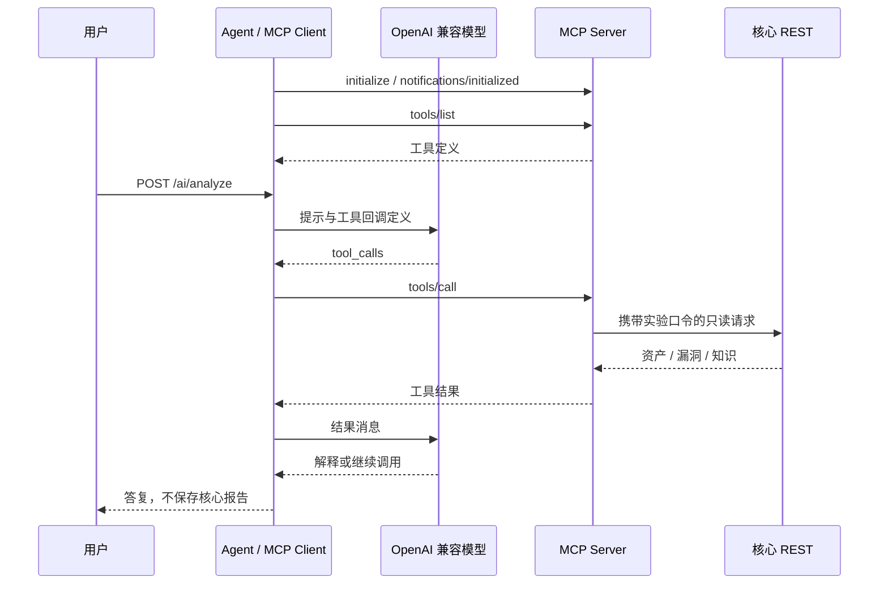

# 第 4 课：Tool Calling 与 MCP

按 2026-10-22 的实现说明。启动参数见 [README](../README.md)，测试范围见[核验记录](09-核验记录.md)。

## 模型提出请求，宿主执行工具

Tool Calling 是模型返回函数名和参数的交互方式。模型不会执行 Java；`ToolSession.call()` 或 Spring AI 回调才进行授权、调用与结果返回。

核心工具名为 `get_asset`、`get_vulnerabilities`、`search_knowledge`。模型返回的请求示例：

```json
{
  "role": "assistant",
  "tool_calls": [
    {
      "id": "call_1",
      "type": "function",
      "function": {
        "name": "get_asset",
        "arguments": "{\"ip\":\"192.0.2.10\"}"
      }
    }
  ]
}
```

`ModelClient.reason` 将工具结果作为 `role=tool` 且带对应 `tool_call_id` 的消息回传，继续请求模型。非法工具 / 参数在工具层拒绝并返回错误结果；模型 HTTP / 协议或预算失败则使整个分析失败。

`CoreIntegrationTest` 配合 `FakeModelServer` 验证两轮消息和工具结果；它是实际 HTTP 协议集成测试，但模型端为测试服务。

## 当前核心 Schema 的已知缺陷

实际 `GET /api/tools` 的 `function.parameters` 当前是 `["ip"]` 或 `["query"]`。`ToolSchemas.definition()` 的链式构造最终保存了 required 数组，没有返回根对象；现有假模型不会校验请求 Schema，因此测试通过不能证明真实模型兼容。

下面是**应达到的定义示意，当前接口尚未返回此结构**：

```json
{
  "type": "function",
  "function": {
    "name": "get_asset",
    "description": "查询目标资产",
    "parameters": {
      "type": "object",
      "properties": { "ip": { "type": "string" } },
      "required": ["ip"],
      "additionalProperties": false
    }
  }
}
```

整改练习应先增加根对象、properties、required 和 additionalProperties 的真实结构断言，再修复构造并联调真实模型。运行时的参数和 IP 校验仍存在，但不能替代向模型提供合法定义。Spring `@Tool` 的 Schema 由框架生成，与这段手写构造分开。

## MCP 的接入边界

MCP 规范工具发现与调用，本项目使用 `initialize`、`tools/list`、`tools/call`；Server 显式配置 `protocol: STREAMABLE`、同步类型和 8082 的 `/mcp` 端点，不依赖传输默认值。



MCP Server 不需要模型配置，不保存业务副本。Agent 以 `mcp` profile 启用 Client；local 则显式使用 `--lab.tool-backend=local`。当前裸配置选择 MCP 业务模式但未启用 Client，不能把裸启动当成 local。

工具名在两套实现中不同：

| 层                        | 名称                                               |
| ------------------------- | -------------------------------------------------- |
| 核心手写工具              | get_asset / get_vulnerabilities / search_knowledge |
| Spring @Tool / MCP Server | getAsset / getVulnerabilities / searchKnowledge    |
| MCP Client 注入模型       | 以发现到的回调名为准，可能含连接前缀               |

普通对象用 `.tools(...)`，`ToolCallbackProvider` 用 `.toolCallbacks(...)`。MCP 提供适配与协议统一，不替代核心权限、事务、数据库或业务 Service；STDIO 子进程传输是另一种可选接入，本项目未配置。

## 从当前实现扩展

1. 先完成核心 Schema 修复及真实模型验证练习。
2. 当前 get_asset 已返回 ports。若为了学习增加独立 `get_asset_ports`，同时更新工具枚举、调度、参数校验、定义及测试，避免仅增加提示词。
3. 在 `RequestScopedAssetTools` 与 `McpAssetTools` 实现同一只读能力；需要同名时显式指定 `@Tool(name=...)`。
4. 比较 local / MCP 链路的结果、授权边界、错误和耗时。
5. 为真实复用需求决定是否增加 MCP；已有 REST / Feign / SDK 仍可承担业务访问。

框架配置参考 [Spring AI MCP Client](https://docs.spring.io/spring-ai/reference/1.1/api/mcp/mcp-client-boot-starter-docs.html)。在线 1.1 文档会随补丁版本更新，本仓库固定 1.1.0，实际行为还需对照本地依赖和测试。
